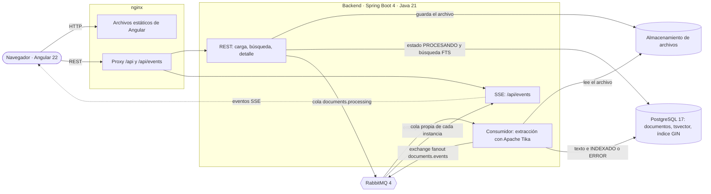
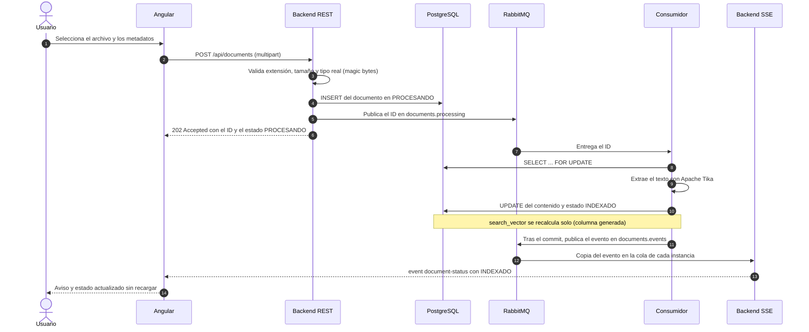
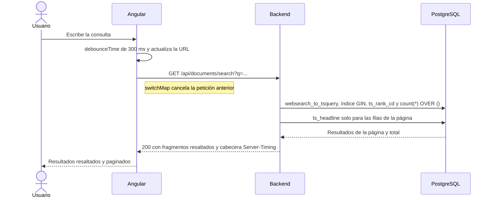
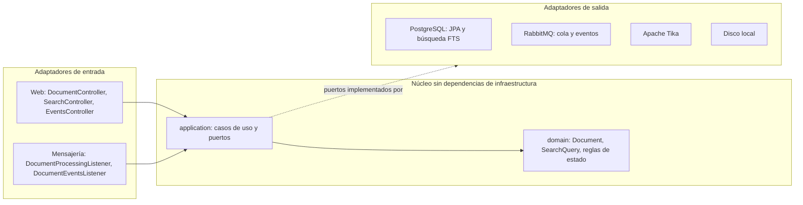

# Arquitectura — Technical Docs Search

Aplicación web para cargar documentos técnicos (PDF, TXT y Markdown), indexarlos en segundo plano, buscarlos con texto completo y visualizarlos, con notificaciones en tiempo real cuando termina el procesamiento.

- **Backend:** Java 21 + Spring Boot 4, arquitectura hexagonal.
- **Búsqueda:** PostgreSQL 17 Full-Text Search (`tsvector` + índice GIN). Sin `LIKE`.
- **Procesamiento asíncrono:** RabbitMQ 4 + Apache Tika.
- **Tiempo real:** Server-Sent Events con fanout por instancia.
- **Frontend:** Angular 22 (standalone, signals, zoneless) + Angular Material 3.
- **Ejecución:** `docker compose up --build` levanta todo; la app queda en http://localhost.

Los diagramas de este documento están en Mermaid para que GitHub los muestre directamente. Su versión editable está en [`diagrams/architecture.drawio`](diagrams/architecture.drawio), con una página por diagrama; se abre en [draw.io](https://app.diagrams.net) o con la extensión de draw.io para VS Code o IntelliJ.

## Índice

1. [Diagrama de arquitectura](#1-diagrama-de-arquitectura)
2. [Flujos principales](#2-flujos-principales)
3. [Arquitectura hexagonal del backend](#3-arquitectura-hexagonal-del-backend)
4. [Justificación del stack](#4-justificación-del-stack)
5. [Motor de búsqueda y tiempos de respuesta](#5-motor-de-búsqueda-y-tiempos-de-respuesta)
6. [Estrategia de tiempo real](#6-estrategia-de-tiempo-real)
7. [Procesamiento asíncrono y concurrencia](#7-procesamiento-asíncrono-y-concurrencia)
8. [Escalabilidad](#8-escalabilidad)
9. [Seguridad](#9-seguridad)
10. [Calidad y pruebas](#10-calidad-y-pruebas)
11. [Compromisos conocidos](#11-compromisos-conocidos)

---

## 1. Diagrama de arquitectura

| Componente | Responsabilidad |
| --- | --- |
| nginx | Sirve la app y es el único punto de entrada del navegador: proxy de `/api` y de `/api/events` sin buffering. Mismo origen, sin CORS |
| REST | Valida y acepta cargas (respuesta inmediata `202`), búsqueda y detalle |
| Consumidor | Extrae el texto, actualiza el estado y publica el evento de cambio de estado |
| SSE | Mantiene las conexiones abiertas de los navegadores y les reenvía los eventos |
| PostgreSQL | Datos, metadatos, texto extraído y el índice de búsqueda (`search_vector` generado + GIN) |
| RabbitMQ | Cola durable de trabajo (con reintentos y DLQ) y exchange fanout de eventos |

El consumidor y el SSE forman parte del mismo backend (monolito modular), pero se comunican a través de RabbitMQ. Eso permite ejecutar varias instancias sin coordinación adicional.

## 2. Flujos principales

### Carga, indexación y notificación (HU-01 + HU-04)

### Búsqueda (HU-02)

## 3. Arquitectura hexagonal del backend

| Capa | Contenido | Regla |
| --- | --- | --- |
| `domain` | `Document` (agregado con las transiciones de estado), `DocumentMetadata`, `DocumentFormat`, `SearchQuery`, `HighlightedText`, excepciones de negocio | Java puro: sin Spring ni anotaciones |
| `application` | Puertos de entrada (`UploadDocumentUseCase`, `ProcessDocumentUseCase`, `GetDocumentUseCase`, `SearchDocumentsUseCase`), puertos de salida (`DocumentRepositoryPort`, `SearchEnginePort`, `FileStoragePort`, `ContentTypeDetectorPort`, `TextExtractorPort`, `ProcessingQueuePort`, `StatusNotifierPort`) y servicios | Solo conoce al dominio |
| `infrastructure` | Controladores, listeners, persistencia JPA, búsqueda SQL nativa, RabbitMQ, Tika, almacenamiento, SSE y configuración | Implementa los puertos |

Las dependencias solo apuntan hacia dentro. El beneficio se vio en la práctica: para añadir el tiempo real (HU-04) bastó con sustituir el adaptador de `StatusNotifierPort`, de uno que solo escribía en el log a uno que publica en RabbitMQ, **sin tocar los casos de uso**. De la misma forma, pasar a OpenSearch o a S3 sería escribir un adaptador nuevo.

Estructura del frontend: `core/` (API, SSE, interceptor, modelos, seguimiento de cargas), `features/` (`upload`, `search`, `viewer`, una carpeta por historia) y `shared/` (componentes reutilizables).

## 4. Justificación del stack

### Backend: Java 21 + Spring Boot 4

El problema combina dos tipos de carga: muchas conexiones abiertas y ligeras (SSE, búsquedas) y trabajo intensivo de CPU (extraer texto de PDF).

| Necesidad | Cómo la cubre | Alternativas descartadas |
| --- | --- | --- |
| Miles de conexiones SSE abiertas | **Virtual threads**: cada conexión espera en un hilo virtual de pocos KB, con código imperativo simple | WebFlux (misma capacidad, más complejidad) |
| Extracción de PDF sin bloquear al resto | La JVM ejecuta varios hilos en paralelo real | Node.js (Express, NestJS): un solo hilo de eventos. FastAPI: el GIL limita el paralelismo de CPU |
| Extracción robusta de texto y detección del tipo real | **Apache Tika** (PDFBox, detección de codificación y de tipo por magic bytes) | Librerías de PDF de Node, menos robustas |
| Rúbrica de calidad | `@RestControllerAdvice` + `ProblemDetail`, Bean Validation, configuración tipada y validada, Flyway, Spring AMQP con reintentos y DLQ, Actuator, Testcontainers | En Express o FastAPI, cada pieza es una librería a elegir e integrar |

Coste asumido: más código de base que en Node. Se compensa con records de Java, Lombok solo en infraestructura y una estructura que el compilador ayuda a mantener.

### Frontend: Angular 22

- **RxJS encaja con el tiempo real y la búsqueda:** `EventSource` como flujo, `debounceTime` + `switchMap` para cancelar peticiones obsoletas.
- **Signals y zoneless:** un evento SSE solo repinta la fila afectada.
- **Todo integrado:** router, `HttpClient` con interceptores, formularios reactivos, inyección de dependencias y testing, sin elegir y ensamblar librerías.
- **Seguridad por defecto:** el escapado y el `DomSanitizer` cubren los riesgos de mostrar fragmentos resaltados y Markdown subido por usuarios.
- Descartados: React (más decisiones de librerías para un día de trabajo) y Next.js (no hay requisito de SSR ni de SEO; añadiría un servidor intermedio que complica el SSE).

### Mensajería: RabbitMQ

Durabilidad (los trabajos sobreviven a reinicios, a diferencia de `@Async`), reintentos con backoff y dead-letter queue, consumidores que escalan aparte de la API y, con el mismo broker, el fanout de eventos de tiempo real.

### Motor de búsqueda: PostgreSQL Full-Text Search

| Motor | A favor | En contra | Decisión |
| --- | --- | --- | --- |
| PostgreSQL FTS | Sin infraestructura extra, transaccional, resaltado incluido, migraciones con Flyway, SLA medido y cumplido | Relevancia más básica; sin tolerancia a errores tipográficos de serie | **Elegido** |
| Meilisearch | Muy rápido, tolerante a errores tipográficos | Segundo almacén que mantener sincronizado | Alternativa válida |
| Elasticsearch / OpenSearch | Máxima escala y analizadores avanzados | 1–2 GB de RAM mínimo y operación compleja; desproporcionado para este volumen | Plan de escalado |
| MongoDB Text Index | Simple de activar | Un solo índice de texto por colección, sin resaltado nativo | Descartado |

## 5. Motor de búsqueda y tiempos de respuesta

### Diseño

- **Configuración `es_unaccent`:** copia de la configuración `spanish` con el diccionario `unaccent` antes del stemmer. Indexar, consultar y resaltar comparten la misma normalización: `BUSQUEDA` encuentra y resalta "búsqueda" con su tilde original.
- **`search_vector` como columna generada** (Postgres la mantiene sola, nunca se desincroniza), con pesos: **A** título, **B** autor, categoría y etiquetas, **C** contenido (primeros 1.000.000 de caracteres, para respetar el límite de 1 MB de `tsvector`).
- **Índice GIN parcial** `WHERE status = 'INDEXADO'`: más pequeño, y expresa la regla de que solo se busca lo ya indexado.
- **`websearch_to_tsquery`:** sintaxis de buscador web: `"frase exacta"`, `-exclusión`, `or`.
- **Ranking con `ts_rank_cd`** (normalización 1: un documento enorme no gana solo por su tamaño).
- **El total sale de `count(*) OVER ()`** en la misma consulta que ordena. Un `COUNT(*)` aparte costaba ~320 ms con términos comunes.
- **El ranking solo arrastra columnas ligeras** (`id`, fecha, `score`). El título y el contenido se leen solo para las filas de la página. Antes, la función de ventana volcaba a disco el contenido de todas las coincidencias.
- **`ts_headline` solo sobre la página** y sobre los primeros 100.000 caracteres de cada documento.
- **El resaltado viaja como fragmentos `{text, match}`**, no como HTML: el cliente lo pinta con `<mark>`, sin `innerHTML`.
- **Ningún `LIKE`:** `NoLikeOperatorTest` hace fallar el build si aparece `LIKE`, `ILIKE`, `~~` o una consulta derivada de Spring Data que lo genere.

### Interpretación del requisito de 400 ms a 1 s

Se interpreta como "la búsqueda responde en 1 s o menos", con un objetivo de p95 por debajo de 400 ms. No se añade latencia artificial para alcanzar el mínimo.

### Resultados medidos

Entorno: Mac con Docker Desktop, **100.007 documentos** sintéticos con vocabulario realista (`scripts/seed/seed.sh`), PostgreSQL 17 con la memoria ajustada en `docker-compose.yml`. Prueba de carga con k6 (`scripts/benchmark/search-load.js`): 10 usuarios concurrentes durante 1 minuto, mezclando términos comunes y raros, frases y exclusiones.

| Métrica | Primera versión | Versión optimizada |
| --- | --- | --- |
| p95 | 762 ms | **373 ms** |
| p90 | 660 ms | **305 ms** |
| Mediana | 143 ms | **62 ms** |
| Búsquedas por segundo | 39,6 | **84,4** |
| Errores | 0 % | 0 % |

Los umbrales de k6 (`p(95) < 1000 ms`, menos del 1 % de errores) pasan en ambas versiones.

Plan de ejecución (`scripts/benchmark/explain.sh rendimiento`, 6.488 coincidencias): `Bitmap Index Scan on idx_documents_search` en 7–11 ms. Tiempo total de la misma consulta: 4,4 s justo tras reiniciar Postgres (caché vacía), 300 ms en la segunda ejecución y **77 ms con la caché caliente**.

Cómo se llegó a la versión optimizada:

1. El primer seed tenía tan pocas palabras que todas aparecían en el 100 % de los documentos. Se rehízo con un vocabulario realista.
2. `EXPLAIN` mostró que el `COUNT(*)` aparte costaba más que la propia página: se sustituyó por `count(*) OVER ()`.
3. `EXPLAIN` mostró `temp written` en la función de ventana: se separó el ranking (columnas ligeras) de la carga de la página.
4. Con la configuración por defecto (128 MB de caché), el plan leía miles de bloques del disco: se ajustó la memoria de Postgres.

Cada búsqueda expone su duración en la cabecera `Server-Timing` y en el campo `tookMs`, visibles en las DevTools y en la propia interfaz.

## 6. Estrategia de tiempo real

| Decisión | Motivo |
| --- | --- |
| **Server-Sent Events** en lugar de WebSocket o GraphQL Subscriptions | La comunicación va en un solo sentido (servidor → navegador). SSE usa HTTP estándar, el navegador reconecta solo y no requiere librerías |
| **Sin polling** | Lo prohíbe HU-04, y además genera carga inútil y latencia igual al intervalo |
| **Un único stream por pestaña** (`GET /api/events`) | HTTP/1.1 limita a ~6 conexiones por dominio |
| **Publicación tras el commit** (`TransactionSynchronization.afterCommit`) | El navegador nunca recibe `INDEXADO` antes de que el cambio sea visible; un rollback no publica nada |
| **Exchange fanout + cola anónima por instancia** | Cada instancia recibe todos los eventos y los reenvía a sus clientes: escala horizontal sin sticky sessions (demostrado con dos instancias) |
| **Entrega "como mucho una vez" + reconciliación** | Si se pierde un evento (corte o reconexión), el frontend vuelve a leer el estado de lo pendiente al reconectar y al recargar. La base de datos es la fuente de verdad |
| **`retry: 3000`, heartbeat cada 20 s, `X-Accel-Buffering: no`** | Reconexión automática y conexiones que los proxies no cortan ni acumulan; en nginx, `proxy_buffering off` y 1 h de timeout |
| **Un consumidor por instancia en la cola de eventos** | Los eventos llegan en orden |
| **Cierre ordenado** (`@PreDestroy`) | Al apagar una instancia, los navegadores reconectan a otra |

Eventos que recibe el navegador:

| Evento | Cuándo | Contenido |
| --- | --- | --- |
| `connected` | Al abrir el stream | `retry: 3000` y la hora de conexión |
| `document-status` | Un documento pasa a `INDEXADO` o `ERROR` | `{documentId, title, status, errorMessage, occurredAt}` |
| `:heartbeat` | Cada 20 s | Comentario SSE, sin datos |

En el frontend, `UploadTracker` solo notifica las cargas de la propia pestaña (el stream es compartido entre usuarios) y resuelve la carrera en la que el evento llega antes que la respuesta `202`.

## 7. Procesamiento asíncrono y concurrencia

- **Primero el commit, después el encolado:** la carga no es `@Transactional`, para que el consumidor nunca reciba un ID que aún no existe. Si la publicación falla, el documento pasa a `ERROR` y se responde `503`.
- **Sin archivos huérfanos:** si falla el guardado en la base de datos, se borra el archivo ya almacenado.
- **Por el mensaje solo viaja el ID:** el consumidor siempre lee el estado actual.
- **Idempotencia:** el consumidor carga el documento con `SELECT ... FOR UPDATE` y solo actúa si sigue en `PROCESANDO`. Un mensaje duplicado espera al primero, ve `INDEXADO` y no hace nada.
- **Errores temporales frente a permanentes:** un fallo al leer el archivo se propaga y se reintenta (3 intentos, esperas de 1 s y 2 s). Un PDF corrupto pasa a `ERROR` sin reintentos. Se distinguen con `TaggedInputStream`.
- **Dead-letter queue:** agotados los reintentos, un listener de la DLQ marca el documento como `ERROR`. Ninguno se queda en `PROCESANDO` para siempre.
- **`prefetch: 1`:** los PDF pesados se reparten entre consumidores en lugar de acumularse en uno.

## 8. Escalabilidad

Cada pieza escala por separado porque la API no guarda estado, el trabajo pesado pasa por una cola y los eventos se reparten por fanout.

| Si crece… | Primer paso | Paso siguiente |
| --- | --- | --- |
| Usuarios buscando | Más instancias de la API detrás de un balanceador | Réplicas de lectura de Postgres para las búsquedas; caché de consultas frecuentes |
| Documentos subidos por minuto | Más consumidores (variables `PROCESSING_CONCURRENCY` y `PROCESSING_MAX_CONCURRENCY`, o más instancias) | Colas separadas por tipo o tamaño de documento |
| Conexiones SSE | Más instancias: el fanout ya lo permite | Gateway de eventos dedicado para cientos de miles de conexiones |
| Volumen de archivos | Adaptador S3 o MinIO para `FileStoragePort` | Ciclo de vida y almacenamiento en frío |
| Número de documentos (decenas de millones) | Particionado de la tabla y troceado de los documentos grandes en fragmentos indexados | Índice RUM (ordena por relevancia desde el índice) o un adaptador de OpenSearch para `SearchEnginePort`, alimentado con el patrón outbox o con CDC (Debezium) |
| Arranques en frío | `pg_prewarm` tras un reinicio y memoria suficiente para el índice | Réplicas que no reinician todas a la vez |

En producción, las mismas imágenes se desplegarían en un orquestador (Kubernetes o ECS), con Postgres y RabbitMQ gestionados y los secretos fuera del `docker-compose.yml`. Con Kubernetes, el despliegue podría gestionarse con GitOps (Argo CD o Flux).

## 9. Seguridad

- **Validación del archivo en dos niveles:** extensión y tipo real por magic bytes. Un ejecutable renombrado a `.pdf` se rechaza con `415`.
- **Sin path traversal:** la clave de almacenamiento es el UUID del documento, nunca el nombre que envía el cliente, y el adaptador comprueba que ninguna ruta salga del directorio raíz.
- **Sin XSS:** el resaltado se transmite como fragmentos y se pinta con interpolación; el Markdown pasa por el `DomSanitizer` de Angular.
- **Sin inyección SQL:** la consulta de búsqueda se compone con fragmentos fijos y todos los valores van como parámetros.
- **Errores sin detalles internos:** `ProblemDetail` (RFC 7807) y un manejador de último recurso que nunca expone trazas.
- **Imagen del backend con usuario no root**, CI con permisos mínimos (`contents: read`) y configuración validada al arrancar.
- **Fuera de alcance:** autenticación y autorización (no las pide el enunciado). Serían el siguiente paso antes de exponer la aplicación.

## 10. Calidad y pruebas

| Ámbito | Tests | Qué cubren |
| --- | --- | --- |
| Backend: dominio y casos de uso | JUnit 5 + Mockito | Transiciones de estado, validaciones, orden "guardar → encolar", idempotencia, clasificación de errores, publicación tras el commit |
| Backend: integración | Testcontainers (PostgreSQL 17 y RabbitMQ 4 reales) | Carga → cola → consumidor → `INDEXADO`; búsqueda con tildes, frases, exclusiones, filtros y paginación; SSE con servidor HTTP y cliente reales |
| Backend: reglas | `NoLikeOperatorTest` | Ningún `LIKE` en el código de producción |
| Frontend | Vitest (33 tests) | Servicio SSE, seguimiento de cargas (carrera y reconciliación), validación, estado de búsqueda en la URL, páginas de carga, búsqueda y visor, resaltado seguro |
| Pila completa | CI con Docker | Construye las imágenes, espera los healthchecks y prueba la app y la API a través de nginx |
| Manual | Colección de Bruno (`bruno/`) | Carga, errores, lote y búsqueda, con aserciones |
| Rendimiento | k6 + `EXPLAIN` | p95 < 1 s con umbrales automáticos y uso del índice GIN |

No se usa H2: la búsqueda depende de SQL específico de PostgreSQL. El CI (GitHub Actions) ejecuta backend, frontend y Docker en cada pull request.

## 11. Compromisos conocidos

| Compromiso | Motivo | Evolución |
| --- | --- | --- |
| `@Transactional` de Spring en la capa de aplicación | Concesión habitual en hexagonal: la alternativa (un puerto de transacciones) añade complejidad sin beneficio en este alcance | Puerto de transacciones si se cambiara de framework |
| Sin patrón outbox | Publicar tras el commit y marcar `ERROR` si falla cubre el caso con poca complejidad | Outbox o CDC a mayor escala |
| Eventos "como mucho una vez" | La reconciliación del cliente cubre las pérdidas | Event store con reproducción por `Last-Event-ID` |
| Se indexa el primer millón de caracteres por documento | Límite de 1 MB de `tsvector` | Troceado en fragmentos indexados |
| Almacenamiento en disco local | Suficiente para una instancia | Adaptador S3 detrás del mismo puerto |
| Interfaz en inglés y estados de la API en español | El enunciado fija `PROCESANDO`, `INDEXADO` y `ERROR`; el resto (código, API e interfaz) comparte idioma | Angular i18n si hiciera falta |
| Tipos del frontend escritos a mano | Contrato pequeño (5 endpoints) cubierto por tests | Cliente generado desde el OpenAPI en `packages/shared` |
